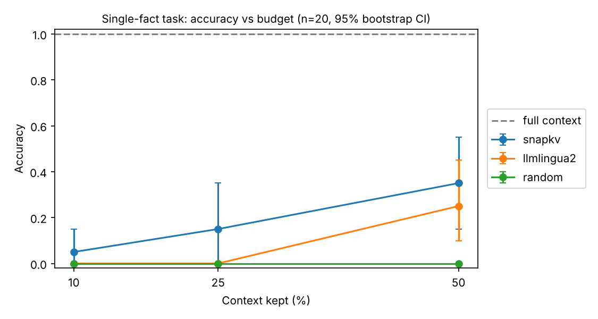
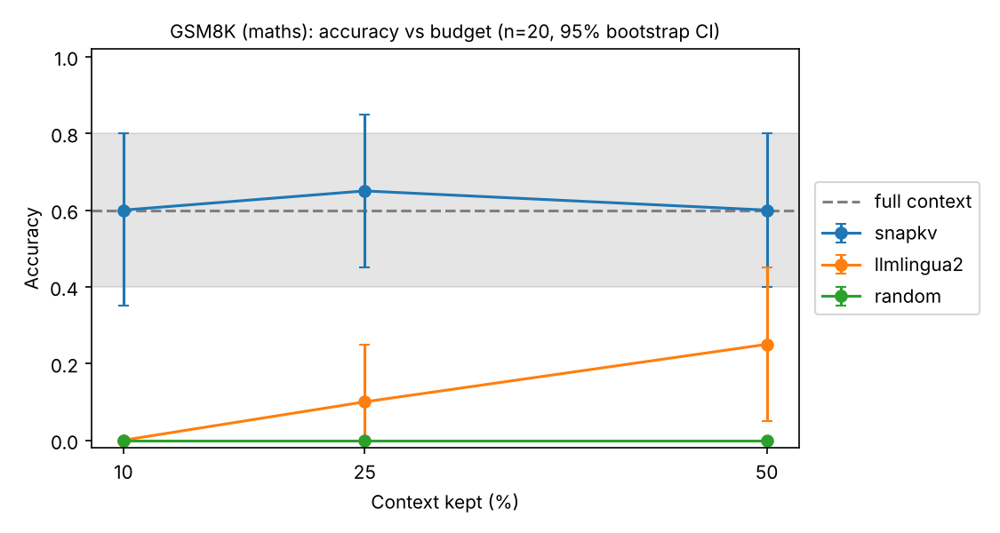

# Pilot results: 20 questions per setting (run 25–26 Nov 2026)

Model: Qwen2.5-1.5B-Instruct on a Colab T4 GPU. Numbers are accuracy (fraction correct out of 20), with 95% bootstrap confidence intervals.

The raw per-answer file (`results_20.jsonl`) was lost when the Colab session timed out. These numbers were copied from the analysis output, and the plots were redrawn from them.

## Single-fact task

| Method | 10% kept | 25% kept | 50% kept |
| --- | --- | --- | --- |
| Full context | 1.00 [1.00, 1.00] | | |
| SnapKV | 0.05 [0.00, 0.15] | 0.15 [0.00, 0.30] | 0.35 [0.15, 0.55] |
| LLMLingua-2 | 0.00 | 0.00 | 0.25 [0.05, 0.45] |
| Random eviction | 0.00 | 0.00 | 0.00 |

Paired McNemar tests: only **SnapKV vs random at 50% kept** is significant (0 / 7, p = 0.016).

## GSM8K (maths)

| Method | 10% kept | 25% kept | 50% kept |
| --- | --- | --- | --- |
| Full context | 0.60 [0.40, 0.80] | | |
| SnapKV | 0.60 [0.40, 0.80] | 0.65 [0.45, 0.85] | 0.60 [0.40, 0.80] |
| LLMLingua-2 | 0.00 | 0.10 [0.00, 0.25] | 0.25 [0.10, 0.45] |
| Random eviction | 0.00 | 0.00 | 0.00 |

Paired McNemar tests: SnapKV beats random at every budget (p < 0.001), and beats LLMLingua-2 at every budget (p = 0.000, 0.003, 0.039).

## What it suggests

- **H2 (single fact) is supported.** Every method collapses as the budget shrinks; SnapKV degrades least.
- **H1 (repetitive task) is only half right.** SnapKV matches the full model even at 10%, but random eviction and LLMLingua-2 collapse.

## Caveats before trusting this

1. Random eviction scores 0% even at 50% kept. This is probably because it also deletes the first tokens and the chat-template tokens, which models depend on. Published random baselines usually protect those.
2. LLMLingua-2 also compressed the maths problem itself, so it can delete numbers the model needs.
3. `kvpress` compresses the context before the question is seen. SnapKV therefore cannot know which run will be asked about, which likely explains its low single-fact score.
4. n = 20 per setting, so confidence intervals are wide. Re-run with `--n 100`.

